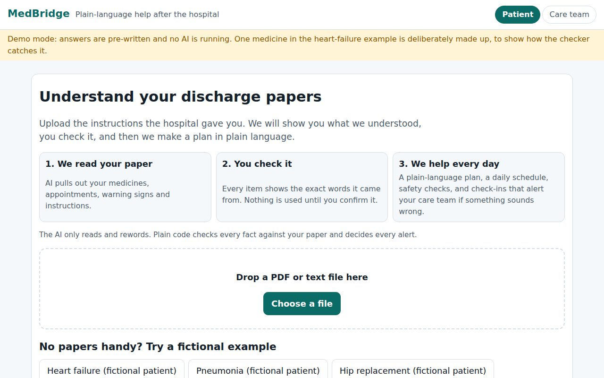
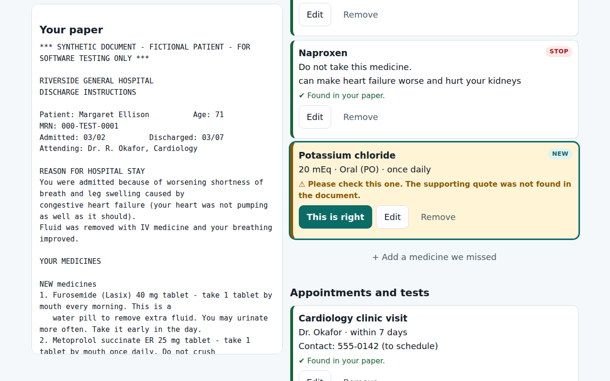
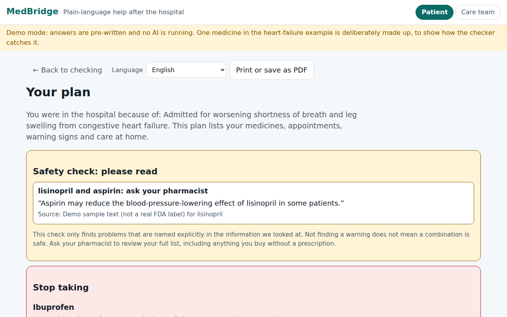
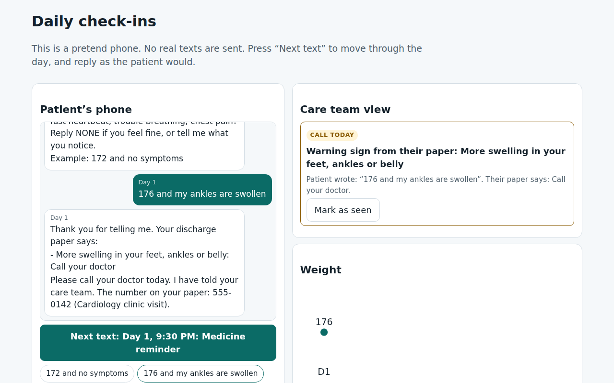
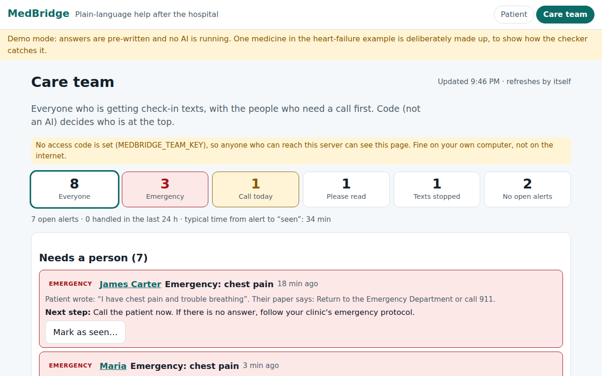
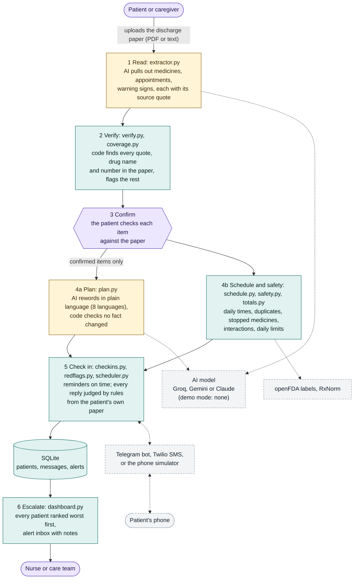

# MedBridge

**After a hospital stay, patients go home with pages of instructions, and many get them wrong.**
MedBridge turns the discharge paper into a plan a patient can actually follow, then checks in every day
and gets a person involved the moment a reply sounds wrong.

> **Not a medical device.** MedBridge only restates what the patient's own clinicians wrote. It does not diagnose,
> prescribe, or give new medical advice. All sample documents are **fictional**; never use real patient data with it.

**[Watch the 90-second demo video](docs/demo/medbridge-demo.mp4)**



## How it works: the AI reads, code verifies, people confirm

| Step | What happens | Who decides |
|---|---|---|
| 1. Read | AI pulls medicines, appointments, warning signs and instructions out of the paper, each with the exact words it came from. | AI proposes |
| 2. Verify | Code checks every item against the paper: the quote must be there, the drug name must be in it, every number (dose, days, phone) must match. Anything that fails is flagged. | Code |
| 3. Confirm | The patient (or a caregiver) checks each item against their paper. Nothing is used until they confirm it. | A person |
| 4. Plan | A plain-language plan (8 languages), a daily schedule, and safety checks: duplicate ingredients, medicines the paper stopped, daily acetaminophen limits, FDA-label interaction hints. | AI rewords, code checks the wording kept every fact |
| 5. Check in | Reminders and a morning check-in by text (phone simulator, Telegram, or Twilio SMS). Replies are judged by rules built from **the patient's own paper**, plus universal emergencies (chest pain, stroke signs, suicidal thoughts...). | Code, never an AI |
| 6. Escalate | Worrying replies reach the care-team dashboard, worst first, with a record of who handled each one. | A person |

| The checker catches a made-up medicine | Safety checks done by code |
|---|---|
|  |  |
| **A worrying reply: the paper's own words, and the care team is told** | **The care team sees everyone, worst first** |
|  |  |

## Architecture



Colours: **yellow** = the AI is used, **teal** = plain code decides, **purple** = a person decides, **grey dashed** = outside services (all optional).

**Where the AI is, and where it is not.** The model is used in only the two yellow steps: reading the paper (`extractor.py`) and
rewording the confirmed plan (`plan.py`). Everything after the patient confirms is plain code: the schedule, the safety checks,
every reminder, the judgement of every reply, and the order of the care-team list. Without any API key, demo mode swaps the AI for
pre-written answers and the rest runs unchanged.

| Part | Files | What it does |
|---|---|---|
| Read and verify | `extractor.py`, `verify.py`, `coverage.py`, `documents.py` | Turns a PDF or text into items with source quotes; code rejects any quote, drug name or number not found in the paper, and lists lines nothing used. |
| Plan | `plan.py`, `schemas.py` | Plain-language plan in 8 languages from confirmed items only; code checks it kept every item, number and "call 911". |
| Safety and schedule | `schedule.py`, `safety.py`, `drugs.py`, `totals.py` | Daily times, duplicate ingredients, stopped-but-listed medicines, FDA-label interaction hints, acetaminophen daily total. |
| Check-ins | `checkins.py`, `redflags.py`, `scheduler.py` | Reminders and morning check-ins on a timer; replies judged by rules from the patient's own paper plus universal emergencies. |
| Channels | `sms.py`, `telegram.py` | Twilio SMS (signed webhook) and a Telegram bot (long polling, no public address needed); the simulator needs neither. |
| Care team | `dashboard.py`, `demo_patients.py` | Ranks every patient by urgency, alert inbox with notes, example patients for demos, optional access code. |
| Storage | `store.py` | One SQLite file. Not encrypted yet: fictional data only. |

## Why you can trust what it says

- **804 automated tests**, including a **336-case safety evaluation**: realistic patient messages (typos, slang, past tense,
  negations) checked against all four sample papers. **0 of 156 emergency test messages are missed**, no calm message
  ("no chest pain") raises an alert, and every vague worry ("I don't feel right") reaches a person. See `backend/tests/test_safety_eval.py`.
- **Failures are conservative.** A lookup that fails says "not checked", never "no problems". A reminder that would arrive hours late is skipped and the care team is told. A text that cannot be delivered is marked "Not delivered" and raises an alert.
- **Accessibility:** 0 WCAG 2 A/AA violations (axe-core) on every screen, light and dark mode; works at phone width.
- **No secrets in the repo:** a test fails if anything shaped like an API key or bot token is ever committed.

## Quickest way (no API key needed: demo mode)

Needs **Python 3.10+** (macOS ships 3.9, which is too old; `brew install python@3.12` or use python.org) and Node.js 20+.

```bash
git clone https://github.com/Shibin506/MedBridge && cd MedBridge
./scripts/run-demo.sh
```

Then open http://localhost:3000. Press Ctrl+C to stop. The first run takes a couple of minutes to install things.

## Run it step by step (no API key needed: demo mode)

```bash
# terminal 1: backend
cd backend
python3 -m venv .venv && source .venv/bin/activate
pip install -r requirements-dev.txt
pytest                                   # 804 tests, the LLM is faked
MEDBRIDGE_DEMO=1 uvicorn app.main:app --port 8000

# terminal 2: frontend
cd frontend
npm install
npm run build && npm run start           # or: npm run dev   ->  http://localhost:3000
```

Open http://localhost:3000 and click one of the fictional examples. Demo mode answers from pre-written
data, so it also works as a hackathon fallback if the Wi-Fi or the API fails.

## Run it with the real AI (free Groq key)

1. Create a free key at https://console.groq.com/keys (it starts with `gsk_`) and click **Copy**.
2. `./scripts/set-key.sh`, then paste it with Cmd+V and press Enter. It saves `.env` and tests the key.
3. `./scripts/run-demo.sh --live`

Gemini and Claude also work. Details, Twilio setup and privacy notes: [docs/setup-keys.md](docs/setup-keys.md).
**Free-tier AI services may use what you send. Only use the fictional sample documents until you have a paid/private setup.**

## More detail

- [docs/phase-1.md](docs/phase-1.md): upload -> verified extraction
- [docs/phase-2.md](docs/phase-2.md): confirm screen -> plain-language plan
- [docs/phase-3.md](docs/phase-3.md): daily schedule and safety check
- [docs/phase-4.md](docs/phase-4.md): text check-ins, alerts, the phone simulator, the reminder timer, Telegram and Twilio
- [docs/phase-5.md](docs/phase-5.md): the care-team dashboard
- [docs/phase-6.md](docs/phase-6.md): the demo script, judge Q&A, the safety evaluation, and known limits
- [docs/setup-keys.md](docs/setup-keys.md): free AI keys (Groq), Telegram bot, Twilio

## Roadmap

| Phase | What | Status |
|---|---|---|
| 1 | Upload -> verified extraction with source quotes | done |
| 2 | Confirm screen, plain-language plan, 8 languages, demo mode | done |
| 3 | Daily schedule, safety checks (duplicates, stopped medicines, interactions, daily limits) | done |
| 4 | Daily check-ins: simulator, Telegram, Twilio SMS; red-flag rules from the patient's paper; reminder timer | done |
| 5 | Care-team dashboard: ranked patients, alert inbox, audit notes, example patients, access code | done |
| 6 | Polish: safety evaluation, accessibility, demo video, docs | done |
| Next | Accounts and encryption, clinician review of the rules, photo input for paper discharge sheets, a pilot with a clinic | |
